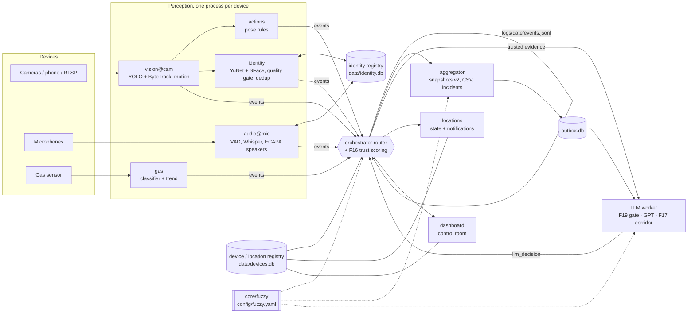
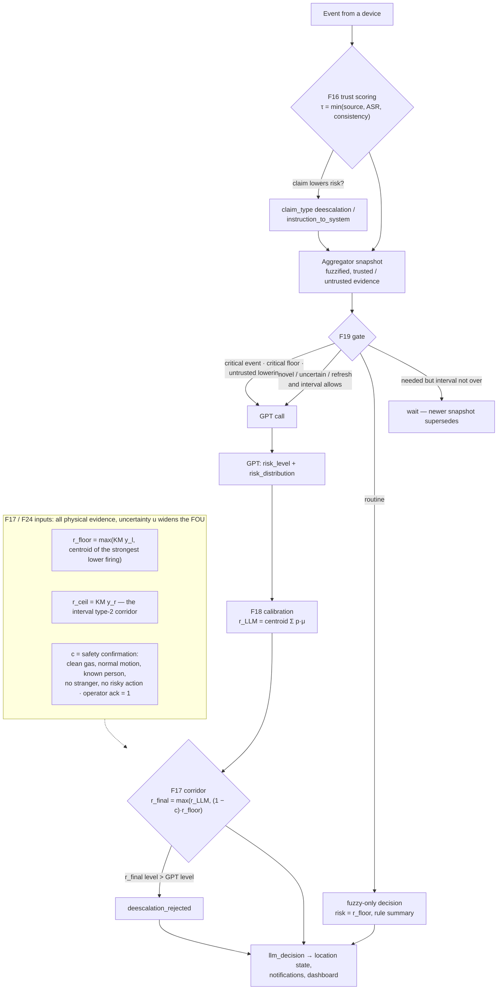

# IoT Guard — fuzzy-bounded LLM security monitoring

Local security system for a Raspberry Pi hub (a Mac works for development): cameras, microphones and a gas sensor
feed one event bus; deterministic modules detect people, actions, identities, speech and gas; GPT explains the
situation, but a **fuzzy risk corridor over trusted physical evidence** decides how low the risk may go.

```bash
python3 -m venv .venv && source .venv/bin/activate && pip install -r requirements.txt
python main.py                      # whole system → http://127.0.0.1:8000
python -m pytest && ruff check core modules tests experiments
python -m experiments.run --all --seed 42 --scripted --llm sim   # evaluation harness (offline)
```

Details per module: `CLAUDE.md`, `modules/vision/README.md`, `modules/trust/README.md`, `modules/envelope/README.md`,
`core/fuzzy/README.md`, `dashboard/README.md`, `experiments/README.md`, `deploy/NETWORK.md`.

## Module dependencies



| Package | Depends on | Provides |
| -- | -- | -- |
| `core/` (events, bus, logger, config, module, orchestrator, devices, identity, fuzzy) | — | event schema v2, processes, registries, fuzzy engine |
| `modules/vision`, `modules/audio`, `modules/gas` | `core` | perception events |
| `modules/trust` | `core/fuzzy` | trust degree τ, provenance, claim type (F16) |
| `modules/aggregator` | `core`, `core/fuzzy` | snapshots, LLM view v2 (F18), outbox |
| `modules/envelope` | `core/fuzzy`, `modules/llm/calibration` | risk corridor + confirmation (F17) |
| `modules/llm` | `envelope`, `aggregator/outbox` | gating (F19), GPT client, calibration (F18) |
| `modules/locations`, `dashboard` | `core` registries | per-location state, notifications, UI |
| `experiments` | all of the above | evaluation harness (F20) |

## How a decision is made



Raising the risk is always allowed; lowering it below the floor needs confirmation (the lower end of an IT2
confirmation interval, so uncertain sensors cannot confirm safety). Speech and scene text never confirm safety —
claims below the cost-fitted `trust.claim_threshold` are quoted to GPT as untrusted evidence and listed as ignored.

## Privacy

Images, audio and embeddings stay on the device (`data/`, `logs/`, `exports/` are local); GPT receives only the
compact text / fuzzified JSON view, never media or raw sensor values. Secrets live in `.env` (never committed).
