<!-- Згенеровано: python -m tools.logic_docs (tools/logic_docs/text/*.md + config). Не редагуйте вручну — змініть шаблон і запустіть знову. -->

# Частина 1. Автономна локальна система (стаття 1)

## 1. Що робить система

Система стежить за приміщеннями (їх називаємо «локаціями»: офіс, склад, квартира) і щосекунди відповідає на одне
питання: наскільки зараз небезпечно в кожній локації. Відповідь — один із чотирьох рівнів ризику: низький,
середній, високий, критичний.

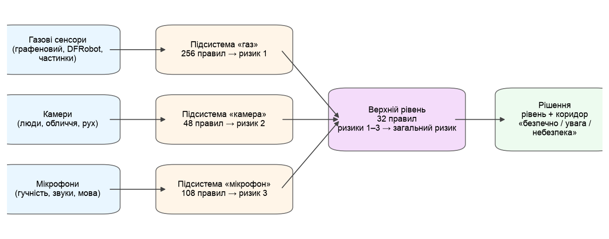

*Рисунок 1. Загальна схема: сенсори → три підсистеми → верхній рівень → рішення*

Сенсори трьох видів дають дані трьом підсистемам. Кожна підсистема окремо оцінює свій ризик: газ — ризик 1,
камера — ризик 2, мікрофон — ризик 3. Верхній рівень поєднує три ризики в один загальний. Разом із рівнем система
показує «коридор» — смугу, у якій може бути справжній ризик з урахуванням похибок сенсорів (розділ 7).

Уся ця частина працює на місці, без інтернету і без мовних моделей на кшталт GPT. Тому її називаємо автономною.

**Нечітка логіка.** Підсистеми побудовано на нечіткій логіці [5]. Звичайна логіка каже «так» або «ні»: газу
більше порогу або менше. Нечітка логіка дозволяє казати «трохи», «помірно», «дуже». Для цього кожне слово
(наприклад, «небезпечно») описують **функцією належності** — кривою, яка для кожного значення показує, наскільки
воно підходить під це слово: від 0 (зовсім не підходить) до 1 (підходить повністю). Такі слова називають
**термами**.

**Правила.** Далі працюють правила на кшталт «якщо газ небезпечний і концентрація різко зростає, то ризик
критичний». Кожне правило спрацьовує з певною силою. Сила — це добуток належностей його умов (Ф нижче), а
результат — зважене середнє висновків усіх правил [6].

> **Ф1.** сила правила = добуток належностей його умов — джерело: [6], [7]

> **Ф2.** ризик = Σ wᵣ · cᵣ / Σ wᵣ (центр мас; wᵣ — сила правила, cᵣ — центр його вихідного слова) — джерело: загальновідома [6]

У кожній підсистемі правил стільки, скільки є комбінацій слів її входів: газ — 256 правил, камера —
48, мікрофон — 108, верхній рівень — 32. Повна таблиця правил гарантує,
що система не має «дір»: на будь-яку комбінацію входів є відповідь.

**Монотонність.** Ще одна властивість повної таблиці — монотонність: якщо будь-який вхід стає гіршим (більше
газу, більше незнайомих), загальний ризик ніколи не зменшується. Це перевірено на сітці точок для всіх чотирьох
баз правил (розділ 9, відповідь на слайд 8).

## 2. Сенсори для Raspberry Pi

Система розрахована на мінікомп'ютер Raspberry Pi. Нижче — сенсори, які ми використовуємо або пропонуємо. Для
кожного вказано, що він вимірює, у яких одиницях, у якому діапазоні та з якою точністю.

**Одиниці.** Гази вимірюють у **ppm** (мільйонних частках: 1 ppm — одна молекула газу на мільйон молекул
повітря) або в **об.%** (відсотках об'єму); частинки диму — у **мкг/м³** (мікрограмах на кубометр). Переведення:

> **Ф3.** 1 об.% = 10 000 ppm

> **Ф4.** мг/м³ = ppm · M / 24,45 (25 °C, 1 атм) — джерело: [2]

*Таблиця 1.*

| Сенсор | Що вимірює | Одиниця | Діапазон | Точність / похибка | Підключення до Raspberry Pi | Джерело |
| -- | -- | -- | -- | -- | -- | -- |
| наш графеновий сенсор (rGO / пористий кремній) | етанол, аміак, ацетон, толуол | об.% | 0,25–14 об.%: починається вище критичного рівня кожного газу | похибка моделі ±0,0074…0,0176 об.% (виміряно) | власна плата, USB / послідовний порт | наші дані: тестова вибірка моделі |
| DFRobot SEN0469 (NH3) | аміак | ppm | 0–100 ppm (до 0,33 × критичного рівня) | роздільність 1 ppm; ±10 % показу або ±5 ppm (більше) | I2C / UART | DFRobot wiki [13]; точність — відповідь DFRobot на форумі |
| DFRobot SEN0466 (CO) | CO | ppm | 0–1000 ppm (до 0,83 × критичного рівня) | роздільність 1 ppm; точність не опубліковано | I2C / UART | DFRobot wiki [13] |
| Winsen MQ-137 (через АЦП ADS1115) | аміак | ppm | 5–500 ppm (до 1,67 × критичного рівня) | наближено: крива R_s/R₀ з паспорта, потрібне власне калібрування R₀ | аналоговий вихід → АЦП ADS1115 на I2C | сторінка продукту Winsen [13] |
| Winsen MQ-7 | CO | ppm | не перевірено | не перевірено | аналоговий вихід → АЦП ADS1115 на I2C | первинного джерела не знайдено |
| Plantower PMS5003 | PM2.5 | мкг/м³ | не перевірено | не перевірено | UART | інструкцію виробника не вдалося отримати |
| Nova Fitness SDS011 | PM2.5 | мкг/м³ | 0–999,9 мкг/м³ (до 4,43 × критичного рівня) | роздільність 0,3; ±15 % або ±10 мкг/м³ (більше) | UART / USB | копія паспорта Nova Fitness [13] |
| Sensirion SPS30 | PM2.5 | мкг/м³ | 0–1000 мкг/м³ (до 4,43 × критичного рівня) | ±10 % або ±10 мкг/м³ (більше) | I2C / UART | копія паспорта Sensirion [13] (±10 мкг/м³ до 100, ±10 % від 100 до 1000) |
| ScioSense ENS160 | індекс якості повітря | індекс | 1–5 індекс | індекс якості повітря (UBA 1–5), TVOC і eCO₂ — не концентрація небезпечного газу: окремий вхід | I2C | паспорт ScioSense ENS160 [13] |

Рисунок нижче показує, яку частину шкали небезпеки покриває кожен сенсор. Вертикальна риска — критичний рівень
відповідного газу (розділ 3).

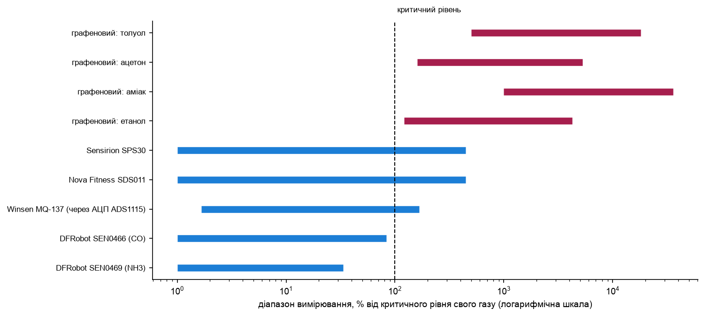

*Рисунок 2. Діапазон кожного сенсора у відсотках від критичного рівня його газу*

Висновок з рисунка: електрохімічні модулі DFRobot для аміаку та CO **закінчуються нижче критичного рівня**
(аміак — на 33 % критичного рівня, CO — на 83 %). Показ на верхній межі такого сенсора означає «щонайменше стільки», і система
показує це як відкриту межу: критичний рівень виключити не можна. Сенсори частинок покривають критичний рівень з
запасом.

**Наш графеновий сенсор** вимірює чотири гази: аміак, етанол, ацетон і толуол. Модель, яка перетворює його криву
опору на назву газу та концентрацію, навчена на наших лабораторних даних [14]. Важливе обмеження: найменша
концентрація в навчальних даних уже не нижча за критичний рівень кожного з цих газів.

*Таблиця 2.*

| Газ | Діапазон навчання моделі | Критичний рівень | Початок діапазону = критичного рівня |
| -- | -- | -- | -- |
| етанол | 0,4 – 14 об.% | 0,33 об.% | 1,2 × (121 %) |
| аміак | 0,3 – 10,8 об.% | 0,03 об.% | 10 × (1000 %) |
| ацетон | 0,4 – 13,2 об.% | 0,25 об.% | 1,6 × (160 %) |
| толуол | 0,25 – 9 об.% | 0,05 об.% | 5 × (500 %) |

Тобто модель ніколи не бачила безпечних концентрацій. Вона вміє відрізнити чисте повітря від газу і назвати газ, але
не вміє розрізнити «безпечно», «помірно» і «небезпечно» нижче критичного рівня. Тому система вважає будь-який
ненульовий показ графенового сенсора щонайменше початком діапазону навчання, тобто не нижче критичного рівня, і
пише про це в журналі. Розрізняти рівні нижче критичного можуть лише сенсори з відповідним діапазоном (таблиця
вище) або модель, перенавчена на нових вимірах малих концентрацій (заплановано).

## 3. Підсистема «газ»

### 3.1. Критичний рівень кожного газу

Різні гази небезпечні в дуже різних кількостях: 10 ppm хлору — уже небезпека для життя, а
стільки ж вуглекислого газу — звичайне повітря (його критичний рівень 40 000 ppm). Тому система не порівнює гази в ppm чи відсотках. Вона ділить концентрацію кожного газу на
його **критичний рівень** — концентрацію, з якої починається безпосередня небезпека для життя (IDLH за NIOSH [1];
для диму PM2.5 — початок категорії «Небезпечний» індексу якості повітря EPA [3]).

> **Ф5.** частка критичного рівня = c / C_крит — джерело: [1], [3] (значення C_крит)

Значення 1 (або 100 %) означає «критичний рівень досягнуто». Так усі гази опиняються на одній шкалі.

*Таблиця 3.*

| Речовина | Критичний рівень | об.% | мг/м³ | НКМПР (вибух) | Група дії | Джерело |
| -- | -- | -- | -- | -- | -- | -- |
| аміак (NH3) | 300 ppm | 0,03 | 209 | 15 об.% | подразники дихальних шляхів | NIOSH IDLH [1] · НКМПР [2] |
| CO | 1200 ppm | 0,12 | 1374,7 | 12,5 об.% | задушливі | NIOSH IDLH [1] · НКМПР [2] |
| PM2.5 | 225,5 мкг/м³ | — | — | — | частинки / дим | EPA AQI 2024 «Небезпечний» [3] |
| етанол (C2H5OH) | 3300 ppm | 0,33 | 6218 | 3,3 об.% | органічні розчинники | NIOSH IDLH [1] · НКМПР [2] |
| ацетон ((CH3)2CO) | 2500 ppm | 0,25 | 5938,7 | 2,5 об.% | органічні розчинники | NIOSH IDLH [1] · НКМПР [2] |
| толуол (C6H5CH3) | 500 ppm | 0,05 | 1884,3 | 1,1 об.% | органічні розчинники | NIOSH IDLH [1] · НКМПР [2] |
| CO₂ (CO2) | 40 000 ppm | 4 | 72 000 | — | задушливі | NIOSH IDLH [1] |
| хлор (Cl2) | 10 ppm | 0,001 | 29 | — | подразники дихальних шляхів | NIOSH IDLH [1] |
| діоксид сірки (SO2) | 100 ppm | 0,01 | 262 | — | подразники дихальних шляхів | NIOSH IDLH [1] |
| діоксид азоту (NO2) | 13 ppm | 0,0013 | 24,5 | — | подразники дихальних шляхів | NIOSH IDLH [1] |
| сірководень (H2S) | 100 ppm | 0,01 | 139,4 | 4 об.% | задушливі | NIOSH IDLH [1] · НКМПР [2] |

Приклади, як читати таблицю:

- **Аміак:** критичний рівень 300 ppm = 0,03 об.%. Отже, 5 об.% аміаку —
  це 16 667 % від критичного рівня: приблизно у 167 раз більше за
  концентрацію, небезпечну для життя.
- **Етанол:** критичний рівень 3300 ppm = 0,33 об.%. Це 10 % від нижньої
  межі вибуховості (3,3 об.%) — так NIOSH визначає IDLH для легкозаймистих речовин [2]. З цього
  рівня починається безпосередня небезпека для життя.
- **Ацетон:** 2500 ppm = 0,25 об.%, межа вибуховості
  2,5 об.% — у 10 раза вище за критичний рівень.

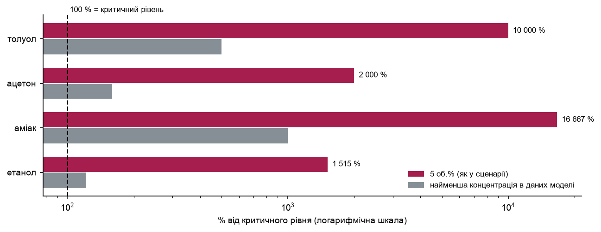

*Рисунок 3. 5 об.% кожного газу графенового сенсора у відсотках від критичного рівня (сірим — найменша концентрація в даних моделі)*

### 3.2. Межа вибуховості

Для горючих газів є ще одна межа — **нижня концентраційна межа поширення полум'я (НКМПР)**: найменша концентрація,
за якої суміш газу з повітрям може вибухнути [2]. Якщо показ досягає її, система додає до рішення позначку
«вибухонебезпечно» і записує це в журнал. Це окрема від рівня ризику ознака: рівень у такому разі завжди
критичний, бо всі межі вибуховості з таблиці набагато вищі за критичні рівні.

### 3.3. Запобіжник: газ на критичному рівні — завжди критично

Крім правил, у системі є незалежна перевірка. Якщо **нижня межа** показу (показ мінус похибка сенсора) досягає
критичного рівня будь-якого газу, остаточний рівень — критичний, що б не вирішили правила чи агенти. Якщо якась
частина системи видала нижчий рівень, це записується як помилка. Кнопка «Підтвердити» на панелі вимикає лише
сповіщення, але не може зробити таку локацію «безпечною».

### 3.4. Входи підсистеми і їхні слова

*Таблиця 4.*

| Вхід / вихід | Шкала | Слова (терми) і їхні точки | Звідки значення |
| -- | -- | -- | -- |
| найвищий газ (частка критичного рівня) | від 0 до 1,2 | безпечно: трапеція (0; 0; 0,1; 0,3) помірно: трикутник (0,1; 0,3; 0,6) небезпечно: трикутник (0,3; 0,6; 1) критично: трапеція (0,6; 1; 1,2; 1,2) | вимога: частка критичного рівня (IDLH NIOSH [1], EPA [3]); межі слів — частки 0,1 / 0,3 / 0,6 / 1 критичного рівня, «критично» з 1 |
| другий активний газ | від 0 до 1,2 | немає: трапеція (0; 0; 0; 0,05) низький: трапеція (0; 0,05; 0,1; 0,3) середній: трикутник (0,1; 0,3; 0,6) високий: трапеція (0,3; 0,6; 1,2; 1,2) | вимога: той самий масштаб для другого активного газу; «немає» — спокійна смуга до 5 % |
| індекс суміші в групі | від 0 до 3,6 | менше 1: трапеція (0; 0; 0,99; 1) досягнуто: трапеція (0,99; 1; 3,6; 3,6) | конструктивне рішення, норматив: сума часток у групі дії; «досягнуто» з 1 — правило сумішей OSHA [4] |
| третій активний газ | від 0 до 1,2 | нижче: трапеція (0; 0; 0,3; 0,6) високий: трапеція (0,3; 0,6; 1,2; 1,2) | вимога: третій активний газ; «високий» — від вершини «небезпечно» найвищого газу |
| швидкість зміни | від -0,5 до 0,5 за хвилину | спадає: трапеція (-0,5; -0,5; -0,1; 0) стабільно: трикутник (-0,1; 0; 0,1) зростає: трикутник (0; 0,1; 0,25) різко зростає: трапеція (0,1; 0,25; 0,5; 0,5) | експертна оцінка: ±0,5 за хвилину = від нуля до критичного за 2 хв; межі слів — експертна оцінка (розділ 3.5) |
| ризик (вихід) | від 0 до 1 | низький: трапеція (0; 0; 0,125; 0,375) середній: трикутник (0,1; 0,35; 0,6) високий: трикутник (0,4; 0,65; 0,9) критичний: трапеція (0,625; 0,875; 1; 1) | конструктивне рішення: ризик 0…1; слова однакової площі — для монотонності |

Головний вхід — **найвищий газ**: найбільша частка критичного рівня серед усіх газів у локації. Його слова прив'язані
до часток критичного рівня: «безпечно» — до 0,1, вершина «помірно» —
0,3, вершина «небезпечно» — 0,6, «критично» повністю — від
1 (тобто від самого критичного рівня). Сусідні криві в сумі завжди дають 1 — це
називається розбиттям Руспіні [9]. Воно потрібне для того, щоб результат змінювався плавно й монотонно.

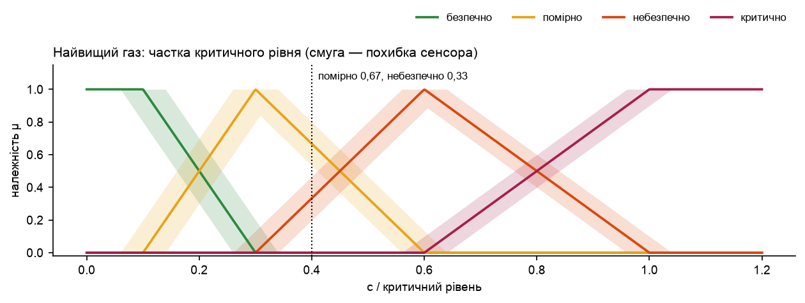

*Рисунок 4. Найвищий газ: функції належності; смуга навколо кожної кривої — похибка сенсора (розділ 7)*

Приклад: показ 0,4 (40 % критичного рівня) належить до «помірно» на 0,67 і до «небезпечно» на
0,33. Обидва слова
діють одночасно, кожне зі своєю силою.

> **Ф6.** трикутна функція належності: μ(x) = max(0, min((x − a)/(b − a), (c − x)/(c − b))) — джерело: загальновідома [5]

> **Ф7.** трапецієвидна: μ(x) = max(0, min((x − a)/(b − a), 1, (d − x)/(d − c))) — джерело: загальновідома [5]

### 3.5. Швидкість зміни (динаміка)

Небезпечний не лише високий рівень, а й швидке зростання. Система рахує, на скільки часток критичного рівня
концентрація змінюється за хвилину. Для цього вона проводить пряму через усі покази за останні
60 с.

> **Ф8.** швидкість = нахил прямої найменших квадратів за останні 60 с, × 60 (за хвилину)

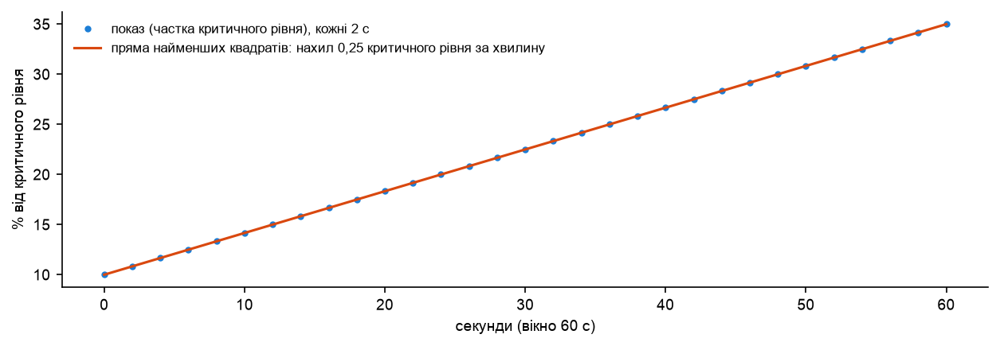

*Рисунок 5. Динаміка: покази за 60 с і пряма, нахил якої — швидкість зміни*

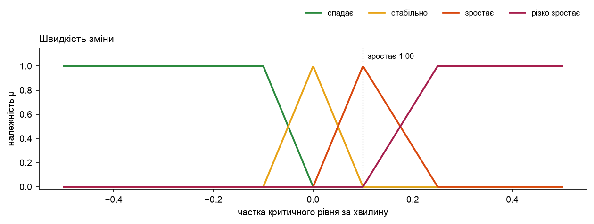

*Рисунок 6. Слова для швидкості зміни*

Шкала — від -0,5 до +0,5 критичного рівня за хвилину. Межа
0,5 означає «від чистого повітря до критичного рівня за 2 хвилини»; швидші зміни
рахуються як ця межа. «Зростає» має вершину 0,1 за хвилину (критичний рівень приблизно через
10 хв), «різко зростає» — повністю від 0,25 за хвилину (критичний рівень менш ніж за 4 хв,
швидше, ніж триває евакуація). Ці межі — експертна оцінка: виміряних даних про швидкості витоків ще немає.

### 3.6. Кілька газів одночасно

Газ вважається **активним**, якщо навіть його нижня межа (показ мінус похибка) вища за 5 % критичного
рівня. Нижче — «спокійна» смуга, де коливання сенсора не вважаються газом.

Правило підвищення:

1. Найвищий газ задає рівень: безпечно → низький, помірно → середній, небезпечно → високий, критично → критичний.
2. Якщо є другий активний газ — рівень піднімається на один щабель (кілька газів одночасно зазвичай означають
   одну подію, наприклад пожежу чи розлив).
3. Критичний рівень — лише з доказом: газ на критичному рівні, сума часток у групі дії досягла 1 (нижче), або три
   гази на високому рівні. Без доказу підвищення зупиняється на «високому».
4. Різке зростання додає ще один щабель; спад рівень не знижує.

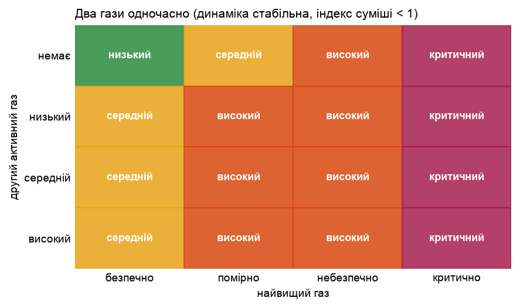

*Рисунок 7. Матриця підвищення: найвищий газ (стовпці) і другий активний газ (рядки)*

**Групи дії.** Гази зі схожою дією на організм складаються: для них діє правило сумішей з норм охорони праці [4].

> **Ф9.** індекс суміші = Σ cᵢ / C_крит,ᵢ ≥ 1 → критично (лише в одній групі дії) — джерело: [4]

*Таблиця 5.*

| Група | Речовини | Чому разом |
| -- | -- | -- |
| задушливі | CO, CO₂, сірководень | заважають диханню / перенесенню кисню |
| подразники дихальних шляхів | аміак, хлор, діоксид сірки, діоксид азоту | подразнюють дихальні шляхи |
| органічні розчинники | етанол, ацетон, толуол | діють на нервову систему (наркотична дія розчинників) |
| частинки / дим | PM2.5 | частинки диму |

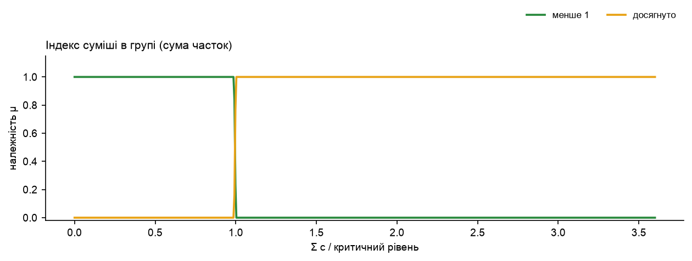

*Рисунок 8. Індекс суміші: «досягнуто» з суми 1*

Приклад (розрахунок справжньою системою): аміак 45 ppm — це
15 % критичного рівня («безпечно» і «помірно»), CO 504 ppm —
42 % («помірно»). Обидва активні, але з різних груп, тож їхня сума не рахується. Сам по собі
найвищий газ дав би «середній»; другий активний газ піднімає рівень на щабель. Результат: ризик газу
0,65, рівень «високий».

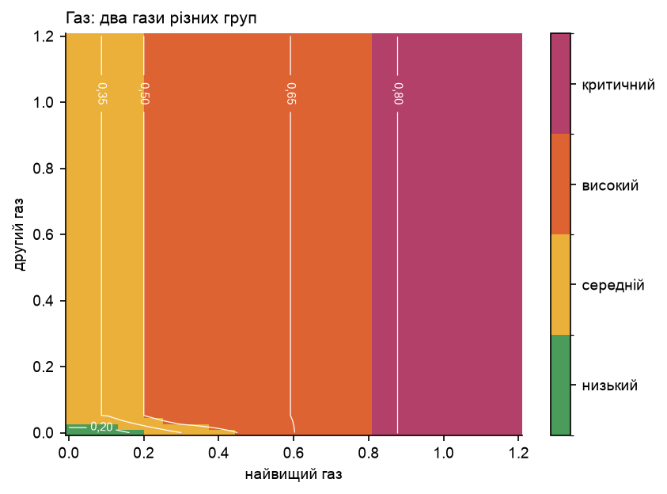

*Рисунок 9. Ризик газу залежно від найвищого і другого газу (різні групи)*

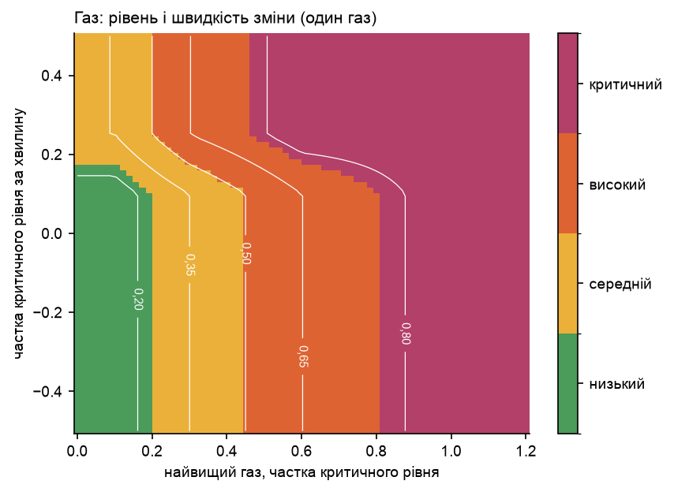

*Рисунок 10. Ризик газу залежно від рівня і швидкості зміни*

### 3.7. Вихід підсистеми

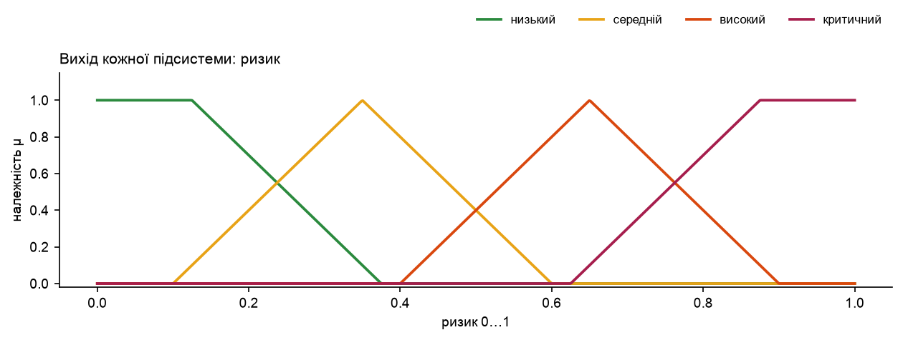

*Рисунок 11. Вихід: ризик 0…1 і чотири рівні*

Чотири вихідні слова мають однакову площу. Їхні центри: низький 0,13, середній
0,35, високий 0,65, критичний 0,87. Однакова
площа робить результат простим зваженим середнім центрів, а отже — монотонним. Рівень — слово з найбільшою
належністю в точці результату.

Приклад: 5 об.% ацетону — це 2000 % критичного рівня. Ризик газу 0,87,
рівень «критичний», позначка «вибухонебезпечно» (НКМПР ацетону 2,5 об.%).

## 4. Підсистема «камера»

*Таблиця 6.*

| Вхід / вихід | Шкала | Слова (терми) і їхні точки | Звідки значення |
| -- | -- | -- | -- |
| частка незнайомих людей | від 0 до 1 | немає: трапеція (0; 0; 0,05; 0,3) частина: трикутник (0,05; 0,3; 0,6) більшість: трикутник (0,3; 0,6; 0,95) усі: трапеція (0,6; 0,95; 1; 1) | вимога, експертна оцінка: частка незнайомих (вимога керівника, слайди 9–11); межі — третини частки |
| інтенсивність руху | від 0 до 1 | немає: трапеція (0; 0; 0,003; 0,01) слабкий: трикутник (0,003; 0,01; 0,05) помірний: трикутник (0,01; 0,05; 0,15) сильний: трапеція (0,05; 0,15; 1; 1) | виміряно, конструктивне рішення: частка кадру, що рухається; «немає» — нижче хибного руху порожніх сцен (виміряно), вершина «помірного» — одна людина, що йде |
| час відносно розкладу | від -12 до 12 год | робочий час: трапеція (-12; -12; -1; 0) перехід: трикутник (-1; 0; 1) неробочий час: трапеція (0; 1; 12; 12) | вимога, конструктивне рішення: години до межі розкладу (±12); «перехід» — ±1 год навколо межі (вимога керівника) |
| ризик (вихід) | від 0 до 1 | низький: трапеція (0; 0; 0,125; 0,375) середній: трикутник (0,1; 0,35; 0,6) високий: трикутник (0,4; 0,65; 0,9) критичний: трапеція (0,625; 0,875; 1; 1) | конструктивне рішення: як у газу |

### 4.1. Частка незнайомих людей, а не їхня кількість

Камера знаходить людей [21] і впізнає обличчя [17]. Вхід підсистеми — **частка незнайомих** серед людей у кадрі, а не
кількість людей. Так попросив керівник (слайди 9–11). Причина: п'ятеро працівників на складі вдень — норма, а один
незнайомий серед них уже вартий уваги. Кількість людей сама по собі нічого не каже про небезпеку.

> **Ф10.** частка незнайомих = N_незнайомих / (N_незнайомих + N_відомих) — джерело: вимога керівника (слайди 9–11)

Людина, яку не вдалося впізнати за 10 с, рахується незнайомою. Впізнавання облич
перевірено на відкритому наборі LFW [17]: правильних рішень щонайменше 99,41 % (нижня межа [10]).

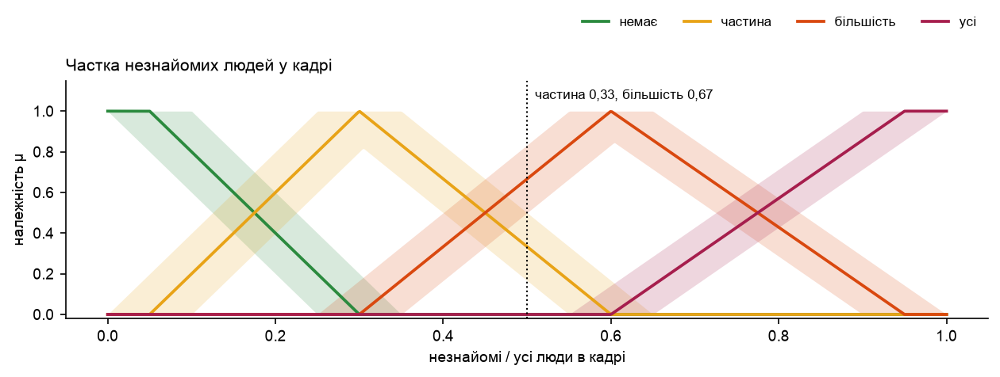

*Рисунок 12. Частка незнайомих: одна відома й одна незнайома людина = 0,5*

### 4.2. Інтенсивність руху

Рух рахується як частка кадру, яка рухається (від 0 до 1), згладжена за кілька секунд. Детектор руху вивчає фон
сцени [12] і пристосовується до умов:

- **Зміна світла.** Коли світло вмикають чи вимикають, яскравість змінюється майже в усьому кадрі однаково. Детектор
  розпізнає такий стрибок, швидко вивчає нове освітлення і кілька секунд не повідомляє про рух.
- **Листя і тіні.** Кадр поділено на 8 × 8 комірок; кожна має власний рівень
  «шуму». Комірка, де листя рухається постійно, з часом стає фоном, а людина, яка проходить за секунди, — ні.
- **Повільні зміни** (хмари, сутінки) детектор просто відстежує: фон оновлюється приблизно за
  20 с.
- Рух рахується, лише якщо він є у двох із трьох кадрів поспіль.

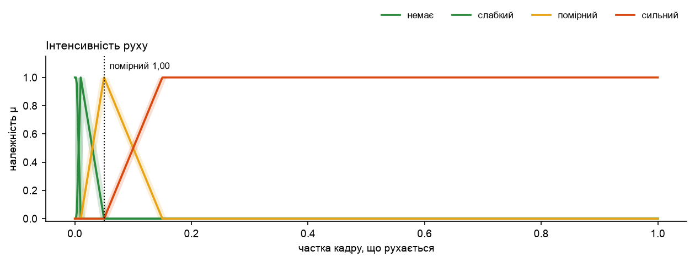

*Рисунок 13. Інтенсивність руху; смуга — похибка детектора*

Межі слів виміряно: на порожніх сценах (світло, листя, шум) детектор показував щонайбільше
0,0066 частки кадру — тому «немає руху» сягає 0,003. Вершина «помірного» —
0,05: приблизно стільки займає одна людина, що йде.

### 4.3. Час: робочі години замість годинника

Замість години доби підсистема використовує **час відносно розкладу** локації: скільки годин до найближчої межі
робочого часу. Мінус — усередині робочих годин, плюс — поза ними, ±1 год навколо межі — «перехід». Це єдине
поняття часу, про яке просив керівник: одна й та сама 23:00 — неробочий час для офісу, але робоча зміна для заводу.

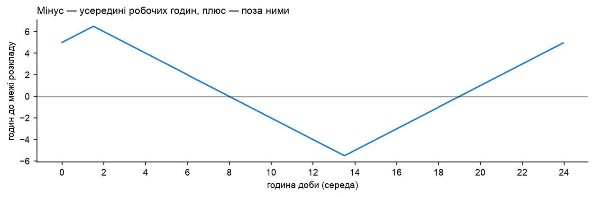

*Рисунок 14. Час відносно розкладу протягом доби (типовий розклад 08:00–19:00)*

*Таблиця 7.*

| Тип об'єкта | Години активності | Дні |
| -- | -- | -- |
| квартира | 07:00–23:00 | усі |
| офіс | 08:00–19:00 | пн, вт, ср, чт, пт |
| склад | 06:00–14:00, 14:00–22:00 | пн, вт, ср, чт, пт, сб |
| завод | 06:00–14:00, 14:00–22:00, 22:00–06:00 | усі |

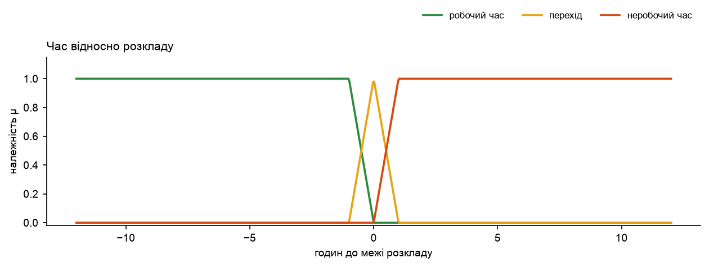

*Рисунок 15. Слова для часу відносно розкладу*

### 4.4. Як працюють правила камери

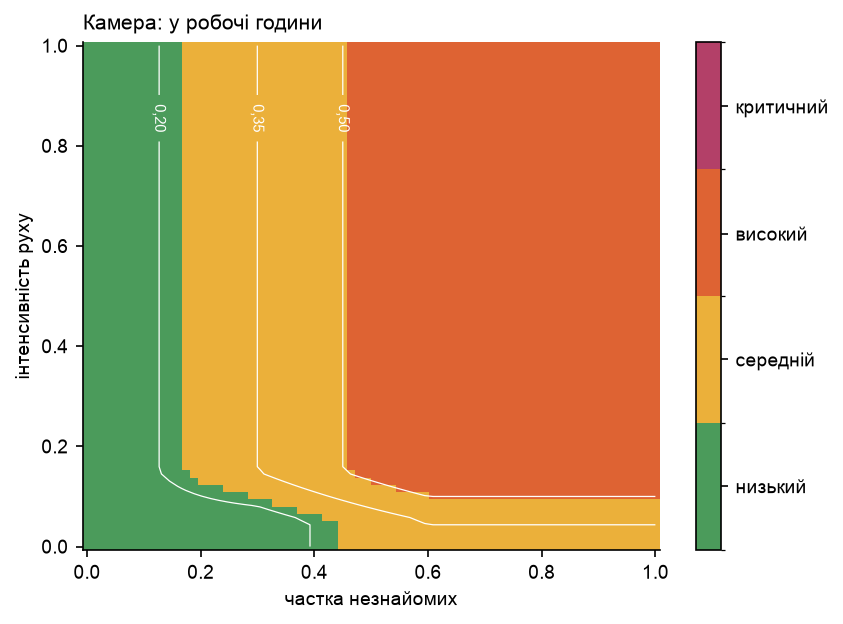

*Рисунок 16. Ризик камери в робочі години*

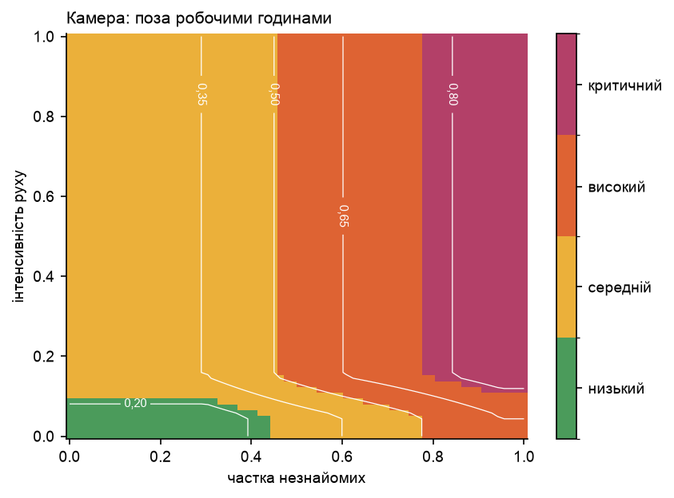

*Рисунок 17. Ризик камери поза робочими годинами*

Приклад: о 23:00 в офісі одна відома й одна незнайома людина, помірний рух. Частка незнайомих 0,5, неробочий час.
Ризик камери 0,28, рівень «середній».

### 4.5. Розпізнавання дій — окремо і вимкнено за замовчуванням

Система вміє розпізнавати дії людей за позою: падіння, бійку, куріння, лежання (режим «дії»). Цей режим вимкнено за
замовчуванням: його вмикають для окремої локації на панелі, бо він потребує більше обчислень. **Дії не входять до
нечітких правил статті 1.** Причини:

1. Для дії важко визначити вимірювану шкалу: «наскільки це схоже на бійку» — не фізична величина (див. відповідь на
   слайд 25).
2. Точність розпізнавання виміряна лише на відкритих наборах даних [19], а не на наших камерах.
3. Правила статті 1 мають бути монотонними й мати виміряні входи.

Дії використовує відеоагент у частині 2: там його заява має вагу, рівну виміряній точності, і не може знизити ризик
нижче коридору нечіткої системи.

## 5. Підсистема «мікрофон»

*Таблиця 8.*

| Вхід / вихід | Шкала | Слова (терми) і їхні точки | Звідки значення |
| -- | -- | -- | -- |
| гучність над фоном | від 0 до 40 дБ | тихо: трапеція (0; 0; 3; 10) помірно: трикутник (3; 10; 20) гучно: трапеція (10; 20; 40; 40) | конструктивне рішення, норматив: дБ над фоном цього мікрофона; межі за рівнями мовлення ANSI S3.5 [11] |
| небезпечність типу звуку | від 0 до 1 | безпечний: трапеція (0; 0; 0,1; 0,4) підозрілий: трикутник (0,1; 0,4; 0,7) небезпечний: трапеція (0,4; 0,7; 1; 1) | вимога: ступінь небезпеки типу звуку; приклади керівника (клавіатура 0, крик 0,8) |
| небезпечні слова | від 0 до 1 | немає: трапеція (0; 0; 0,1; 0,4) тривожні: трикутник (0,1; 0,4; 0,7) небезпечні: трикутник (0,4; 0,7; 1) критичні: трапеція (0,7; 1; 1; 1) | вимога: найвищий ступінь почутих слів; вершини = ступені словника |
| чий голос | від 0 до 1 | відомий: трапеція (0; 0; 0,2; 0,5) невизначений: трикутник (0,2; 0,5; 0,8) невідомий: трапеція (0,5; 0,8; 1; 1) | конструктивне рішення: результат впізнавання голосу: відомий 0, невизначений 0,5, невідомий 1 |
| ризик (вихід) | від 0 до 1 | низький: трапеція (0; 0; 0,125; 0,375) середній: трикутник (0,1; 0,35; 0,6) високий: трикутник (0,4; 0,65; 0,9) критичний: трапеція (0,625; 0,875; 1; 1) | конструктивне рішення: як у газу |

### 5.1. Гучність відносно фону

Ті самі 60 дБ — тиша біля вентилятора і крик у тихій спальні. Тому вхід — не гучність, а **гучність над фоном цього
мікрофона**. Фон — 20-й перцентиль (значення, нижче якого лежить 20 % замірів)
посекундних рівнів за останні 5 хв. Він відстежує, наприклад, увімкнений вентилятор, але не
реагує на короткі звуки.

> **Ф11.** гучність над фоном = рівень кадру − фон (20-й перцентиль медіан за 5 хв), дБ

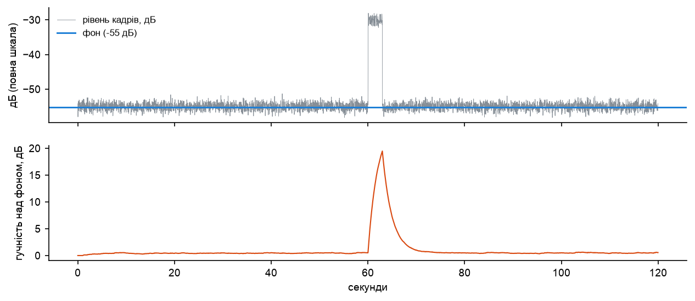

*Рисунок 18. Рівень звуку, фон і гучність над фоном: голосна фраза на 60-й секунді*

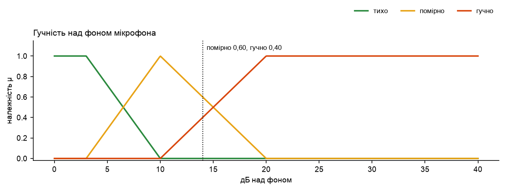

*Рисунок 19. Гучність над фоном*

Межі слів спираються на рівні мовлення зі стандарту ANSI S3.5 [11]: звичайна мова — 62 дБ на відстані 1 м. Почута
за 4 м (рівень падає приблизно на 12 дБ) у тихій кімнаті з фоном 40 дБ, вона приблизно на
10 дБ гучніша за фон — це вершина «помірно». Голосна мова (68–75 дБ на 1 м) чи крик
(82 дБ) — понад 20 дБ над фоном, «гучно». До 3 дБ — звичайні
коливання фону, «тихо» (експертна оцінка).

### 5.2. Тип звуку

Етап шумозаглушення [14] відокремлює фон від мови. Окремі звуки (крик, розбите скло, кроки) мав би розпізнавати
класифікатор типів звуку. Кожному типу експерт присвоїв ступінь небезпеки:

*Таблиця 9.*

| Тип звуку | Небезпечність (0–1) |
| -- | -- |
| клавіатура | 0 |
| кроки | 0,1 |
| вентилятор / механізми | 0 |
| крик | 0,8 |
| невідомий звук | 0,3 |
| удар | 0,6 |
| розбите скло | 0,9 |
| сирена / сигналізація | 0,9 |

Модель класифікатора ще не навчено (заплановано), тому зараз тип звуку не є доказом: вхід «невідомий звук» не
підвищує ризик сам по собі.

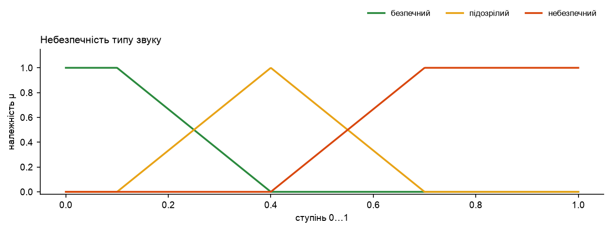

*Рисунок 20. Небезпечність типу звуку*

### 5.3. Словник небезпечних слів

Мова переводиться в текст розпізнавачем Whisper [16], потім текст порівнюється зі словником. Кожне слово має
ступінь:

*Таблиця 10.*

| Ступінь | Значення | Приклади слів (українською) | Слів і фраз |
| -- | -- | -- | -- |
| тривожні | 0,4 | ой, ай, болить, відпусти, не чіпай, стоп | 11 |
| небезпечні | 0,7 | небезпека, допоможіть, рятуйте, поліція, ніж, пістолет, зброя, стріляють … | 16 |
| критичні | 1 | пожежа, вибух, газ | 7 |

Слово знаходиться навіть у зміненій формі («допоможи», «допомоги»). Вхід — найвищий ступінь почутих слів. Вершини
слів збігаються зі ступенями словника: тривожні 0,4, небезпечні 0,7, критичні
1.

Точність виміряно: із 23 небезпечних фраз (синтезована мова з шумом) правильно розпізнано
74 %; нижня межа надійності — 54 % [10]. Ця похибка робить смугу навколо слів
широкою.

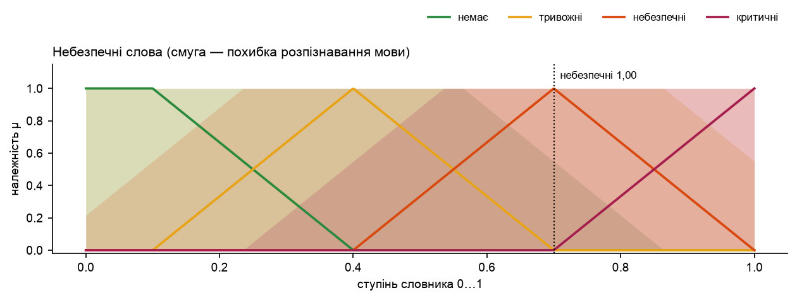

*Рисунок 21. Небезпечні слова; широка смуга — похибка розпізнавання мови*

### 5.4. Чий голос

Система впізнає мовця за голосом [15]: відомий, невизначений або невідомий. Помилка впізнавання (EER — частка, за
якої хибні прийняття дорівнюють хибним відмовам) — 5,3 % на 825 парах голосів.

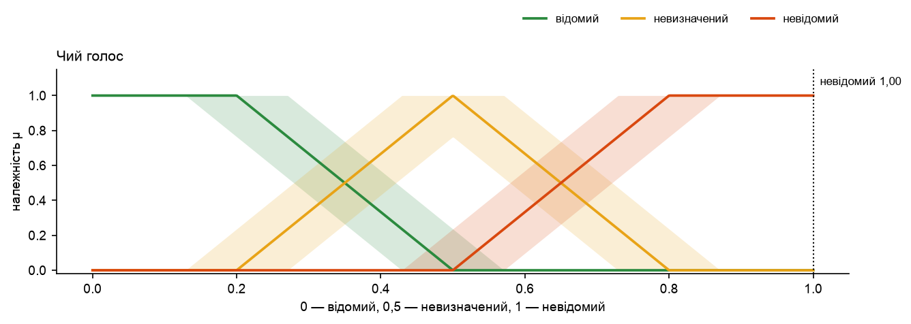

*Рисунок 22. Чий голос*

### 5.5. Як працюють правила мікрофона

Рівень мікрофона — більший із двох:

- **мова:** ступінь слів; невідомий голос, який говорить принаймні помірно гучно і лише тривожні слова (або жодних),
  додає один щабель;
- **звук:** небезпечність звуку плюс один щабель, якщо гучно, мінус один — якщо ні.

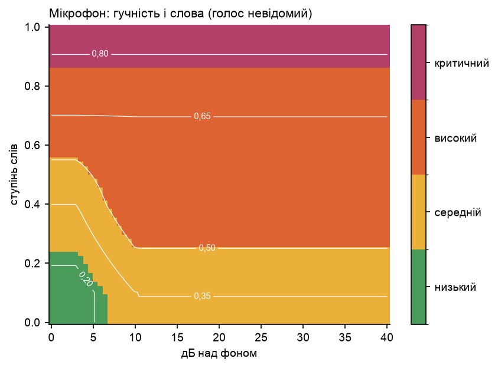

*Рисунок 23. Ризик мікрофона залежно від гучності і слів (голос невідомий)*

Приклад: невідомий голос на 14 дБ над фоном кричить «допоможіть» (небезпечне слово, 0,7). Ризик
мікрофона 0,65, рівень «високий».

## 6. Верхній рівень

*Таблиця 11.*

| Вхід / вихід | Шкала | Слова (терми) і їхні точки | Звідки значення |
| -- | -- | -- | -- |
| найвищий ризик підсистем | від 0 до 1 | низький: трапеція (0; 0; 0,15; 0,35) середній: трикутник (0,15; 0,35; 0,65) високий: трикутник (0,35; 0,65; 0,85) критичний: трапеція (0,65; 0,85; 1; 1) | конструктивне рішення: ризик підсистеми; вершини = центри виходів підсистем, щоб рівень переходив без змін |
| друга активна підсистема | від 0 до 1 | немає: трапеція (0; 0; 0; 0,15) низький: трапеція (0; 0,15; 0,2; 0,35) середній: трикутник (0,2; 0,35; 0,65) високий: трапеція (0,35; 0,65; 1; 1) | вимога: друга активна підсистема (нижня межа коридору вище спокійної смуги) |
| третя активна підсистема | від 0 до 1 | немає: трапеція (0; 0; 0; 0,15) активна: трапеція (0; 0,15; 1; 1) | вимога: чи активна третя підсистема |
| ризик (вихід) | від 0 до 1 | низький: трапеція (0; 0; 0,125; 0,375) середній: трикутник (0,1; 0,35; 0,6) високий: трикутник (0,4; 0,65; 0,9) критичний: трапеція (0,625; 0,875; 1; 1) | конструктивне рішення: як у підсистем |

Верхній рівень отримує три ризики й поєднує їх так само, як підсистема «газ» поєднує кілька газів:

1. Найвищий ризик підсистеми задає рівень.
2. Якщо **друга** підсистема теж активна, рівень піднімається на один щабель: незалежні сенсори, що бачать загрозу
   одночасно, підтверджують одне одного.
3. Критичний — лише з доказом: підсистема на критичному рівні, дві підсистеми на високому, або всі три активні й одна
   з них на високому. Інакше підвищення зупиняється на «високому».

> **Ф12.** загальний рівень = найвищий + 1, якщо друга підсистема активна; критичний — лише з доказом — джерело: вимога керівника (TOD-51), правило системи

Підсистема **активна**, якщо нижня межа її коридору вища за 0,15. Сигнали рахуються разом, якщо
надійшли протягом 60 с. Виняток: у робочі години звичайна мова й люди в кадрі (камера і мікрофон на
низькому рівні) рахуються як один сигнал, щоб звичайний робочий день не піднімав рівень.

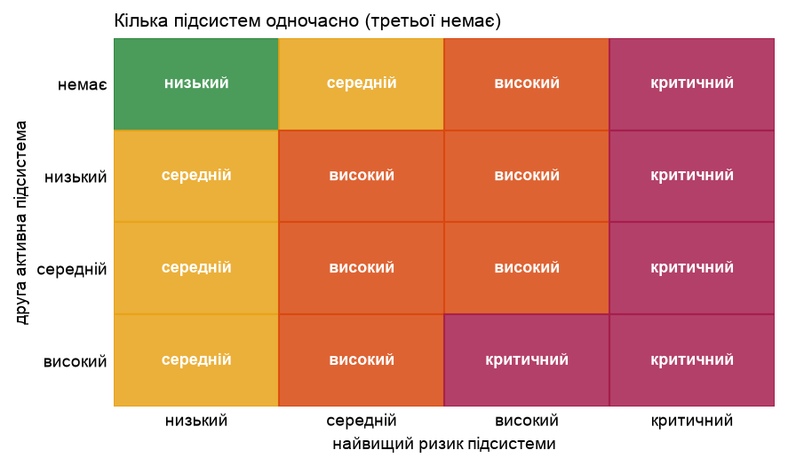

*Рисунок 24. Матриця верхнього рівня: найвищий ризик (стовпці) і друга активна підсистема (рядки)*

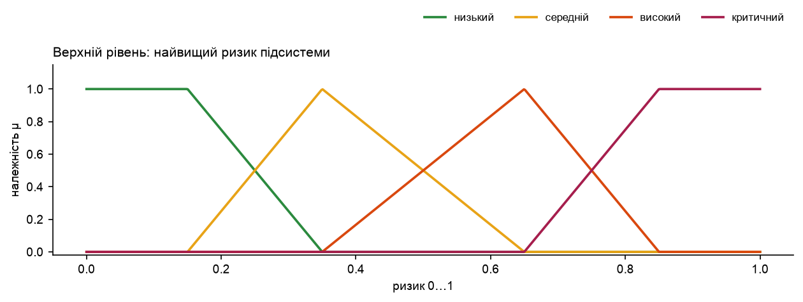

*Рисунок 25. Слова найвищого ризику: вершини збігаються з центрами виходів підсистем*

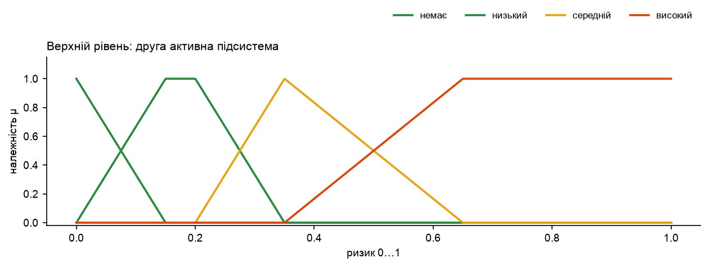

*Рисунок 26. Друга активна підсистема*

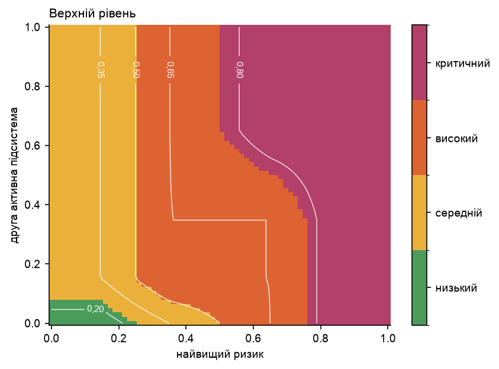

*Рисунок 27. Загальний ризик*

Приклади (розрахунок справжньою системою):

- **Аміак 180 ppm і незнайомий уночі.** Газ — «високий», камера —
  «високий». Дві підсистеми на високому рівні дають загальний рівень
  «критичний», ризик 0,87.
- **Звичайний робочий день.** Двоє відомих людей і помірний рух: «низький», ризик
  0,13.

## 7. Невизначеність і нечіткий коридор

Кожен сенсор має похибку. Аміак 120 ppm на сенсорі з точністю ±10 % — це насправді «від 108 до 132 ppm». Система не
ховає цю похибку, а показує, як вона впливає на рішення.

**Звідки похибки.** Для кожного входу похибка δ (половина ширини можливого діапазону) взята з виміру або паспорта
сенсора:

*Таблиця 12.*

| Вхід | Похибка δ | Джерело |
| -- | -- | -- |
| етанол: графеновий сенсор | ±0,0176 об.% (±5 % критичного рівня) | виміряно на 7 відкладених кривих [наші дані] |
| аміак: графеновий сенсор | ±0,0108 об.% (±36 % критичного рівня) | виміряно на 7 відкладених кривих [наші дані] |
| ацетон: графеновий сенсор | ±0,0121 об.% (±5 % критичного рівня) | виміряно на 7 відкладених кривих [наші дані] |
| толуол: графеновий сенсор | ±0,0074 об.% (±15 % критичного рівня) | виміряно на 7 відкладених кривих [наші дані] |
| аміак: DFRobot SEN0469 | ±10 % показу або ±5 ppm (більше з двох) | паспорт сенсора [13] |
| PM2.5: Nova SDS011 | ±15 % показу або ±10 мкг/м³ (більше з двох) | паспорт сенсора [13] |
| PM2.5: Sensirion SPS30 | ±10 % показу або ±10 мкг/м³ (більше з двох) | паспорт сенсора [13] |
| CO: DFRobot SEN0466 | не опубліковано | паспорт не містить точності — у коридорі 0 |
| частка незнайомих (розпізнавання облич) | ймовірність помилки ≤ 0,0059 на одну людину | виміряно на LFW [17] (650 рішень, нижня межа Вілсона [10]) |
| інтенсивність руху | ±0,0066 частки кадру | виміряно: найбільший хибний рух на порожніх сценах (тест камери) |
| час відносно розкладу | 0 | годинник і розклад точні |
| гучність над фоном | половина розкиду фону (живий розрахунок) | статистика самого мікрофона |
| тип звуку | — | моделі типів звуку ще немає: тип звуку не є доказом (заплановано) |
| небезпечні слова | ±0,465 (оцінка ступеня) | виміряно: 23 небезпечних фраз, точність 74 %, нижня межа 54 % [10] |
| чий голос (впізнавання мовця) | ±0,0708 | виміряно: EER 5,3 % на 825 парах голосів [15] |

**Смуга навколо кривих.** Похибка δ перетворює кожну функцію належності на смугу: верхня крива — краї зсунуті
назовні на δ, нижня — всередину. Це **нечітка множина типу 2** [7]: її належність — не одне число, а проміжок.

> **Ф13.** смуга (тип-2): верхня крива = ребра зсунуті назовні на δ, нижня — всередину на δ — джерело: [7]

**Коридор.** Кожне правило тепер спрацьовує не з однією силою, а з проміжком сил. Алгоритм Карніка–Менделя [8]
знаходить найменший і найбільший можливий результат — **коридор [y_l, y_r]**. Якщо похибок немає (δ = 0), коридор
стягується в одну точку, і результат точно збігається зі звичайним (типу 1).

> **Ф14.** коридор [y_l, y_r] — алгоритм Карніка–Менделя (центр множин) — джерело: [8]

Приклад з числами: аміак 120 ppm = 0,4 критичного рівня; похибка ±12
ppm = ±0,04.

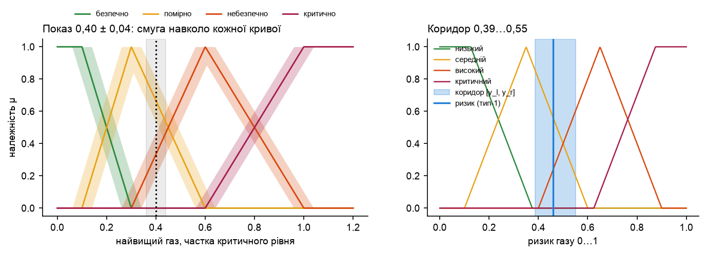

*Рисунок 28. Показ з похибкою (ліворуч) і коридор ризику газу (праворуч)*

Ризик газу 0,46 («середній»), коридор від 0,39
до 0,55. Читати так: з урахуванням похибки сенсора справжній ризик лежить у цьому проміжку.
Широкий коридор означає, що рішення сильно залежить від точності сенсора. Верхній рівень отримує коридори підсистем
і будує загальний коридор; панель показує його смугою на кожному індикаторі ризику.

Під час прогріву сенсора або коли перевірка калібровки ще не пройдена, похибка цього пристрою подвоюється, і
коридор розширюється (розділ 8).

## 8. Калібрування

**Калібрування** — це вимірювання власних характеристик конкретного сенсора: фону мікрофона, фону кадру камери,
кривої чистого повітря газового сенсора. Сенсори ламаються рідко, тому калібрування робиться **один раз** і
зберігається. Під час кожного запуску система лише коротко перевіряє, чи збережене ще відповідає дійсності.

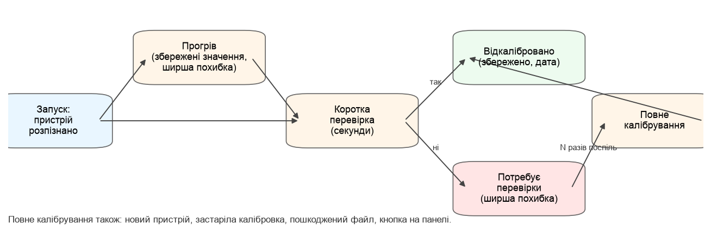

*Рисунок 29. Стани калібрування пристрою*

*Таблиця 13.*

| Сенсор | Що зберігається | Перевірка під час запуску | Прогрів | Найбільший вік | Невдалих перевірок до перекалібрування |
| -- | -- | -- | -- | -- | -- |
| графеновий сенсор | крива чистого повітря, точка Дірака, пік | перший замір чистого повітря проти збереженого | — | 30 дн. | 3 |
| MOS-сенсор (MQ) | R₀ у чистому повітрі | R_s / R₀ після прогріву | 180 с | 30 дн. | 3 |
| електрохімічний | — | заводська | 60 с | — | — |
| сенсор частинок | — | заводська | 30 с | — | — |
| ENS160 | — | заводська | 180 с | — | — |
| мікрофон | рівень фону (дБ) і спектр шуму | 3 с фону проти збереженого | — | 90 дн. | 3 |
| камера | зображення фону і шум кожної комірки | 15 кадрів проти збереженого фону | — | 30 дн. | 3 |

Повне калібрування відбувається лише тоді, коли:

- пристрій новий або змінилася його прошивка;
- калібровка старша за найбільший вік для свого типу;
- коротка перевірка не пройшла кілька разів поспіль;
- оператор натиснув «Перекалібрувати» на панелі (для пристрою або всієї локації; з інструкцією, наприклад
  «забезпечте чисте повітря», показом прогресу і можливістю скасувати).

Попередні версії калібровки зберігаються, і їх можна відновити. **Прогрів — це не калібрування:** електрохімічним і
MOS-сенсорам потрібен фізичний прогрів. У цей час використовується збережена калібровка з ширшою похибкою, а стан —
«прогрів, N хв», а не «не відкалібровано».

Час готовності (імітація з тими самими алгоритмами):

*Таблиця 14.*

| Сенсор | Перший запуск, с | Перезапуск через 1 хв, с |
| -- | -- | -- |
| мікрофон | 60,03 | 3,06 |
| камера | 30,1 | 1,5 |
| графеновий сенсор | 30 | 1 |
| MOS-сенсор (MQ) | 239 | 180 |
| електрохімічний | 60 | 60 |
| сенсор частинок | 30 | 30 |

## 9. Відповіді на запитання керівника

**Слайд 8, п. 1 — чи дають трикутні функції належності монотоннішу поверхню?** Так. Бази правил із трикутними й
трапецієвидними словами на розбитті Руспіні [9] не мають жодного кроку, де ризик зменшується при погіршенні входу.
Ті самі правила з гаусовими кривими мають такі кроки. Перевірка на сітці точок (звіт article1_2026-11-08):

*Таблиця 15.*

| Рівень | Трикутні / трапецієвидні | Гаусові входи | Усе гаусове |
| -- | -- | -- | -- |
| газ | 0 % (0 з 32 400) | 13,6 % (4414 з 32 400) | 14,7 % (4764 з 32 400) |
| камера | 0 % (0 з 3630) | 4,5 % (162 з 3630) | 4,7 % (172 з 3630) |
| мікрофон | 0 % (0 з 8232) | 7,5 % (615 з 8232) | 8,5 % (702 з 8232) |
| верхній рівень | 0 % (0 з 3630) | 10,1 % (365 з 3630) | 10,2 % (369 з 3630) |

Якість рішень на 50 сценаріях з експертними мітками (macro-F1 — середня точність за всіма рівнями,
1 — ідеально): трикутні 0,978, трикутні з коридором 0,96, гаусові входи
0,176, усе гаусове 0,197. Мітки поки чорнові, їх має підтвердити керівник.
Див. розділи 3.4 і 3.7.

**Слайд 8, п. 2–4 — токсичні гази, відсоток від смертельного рівня, суміш, діапазон динаміки.** Кожен газ
порівнюється у відсотках від свого критичного рівня (IDLH за NIOSH [1], для диму — EPA [3]); суміші однієї групи дії
складаються за правилом сумішей [4]; динаміка має шкалу ±0,5 критичного рівня за хвилину. Див. розділи 3.1, 3.6 і
3.5.

**Слайди 9–11 — виявлення руху, частка незнайомих, чому не використовується ризик дій, єдиний час доби.** Рух —
адаптивний детектор зі стійкістю до зміни світла й листя (розділ 4.2). Камера рахує частку незнайомих, а не
кількість людей (розділ 4.1). Дії не входять до правил статті 1 і використовуються лише відеоагентом частини 2
(розділ 4.5). Час — відносно розкладу локації (розділ 4.3).

**Слайд 14 — три підсистеми і верхній рівень.** Газ, камера і мікрофон дають ризики 1–3, верхній рівень їх
поєднує з правилом підвищення (розділи 1, 6).

**Слайд 22 — звідки довіра й невизначеність.** У статті 1 довіра до сенсора — це його виміряна точність. Похибка δ
кожного входу задає смугу навколо функцій належності, а коридор показує її вплив на рішення (розділ 7). Модель
довіри з підтвердженнями й спростуваннями [18] у статті 1 не використовується: справжні сенсори рідко можна
підтвердити чи спростувати, тож її лічильники лишалися б порожніми.

**Слайд 25 — як визначено значення на осі x функцій належності.** Кожна вісь — вимірювана величина у своїх
одиницях: частка критичного рівня газу, частка людей, частка кадру, години до межі розкладу, дБ над фоном, ступінь
словника, результат впізнавання голосу. Звідки кожна межа слів — у стовпці «Звідки значення» таблиць розділів 3–6.
Ознака «підозра на відтворений запис» не мала вимірюваної шкали, тому в статті 1 її немає.

**Слайд 26 — звідки взялися пороги, зокрема колишній 0,42.** У статті 1 кожна межа слова має джерело: норматив,
паспорт, вимір, вимогу або експертну оцінку з поясненням (таблиці розділів 3–6). Порогів рівнів немає: рівень — це
слово з найбільшою належністю на виході. Число 0,42 — це поріг довіри до мовних заяв у гібридній схемі з GPT
(частина 2). Він не був вибраний вручну, а підібраний за мінімальною очікуваною вартістю помилок на тренувальних
сценаріях; у статті 1 його немає.
