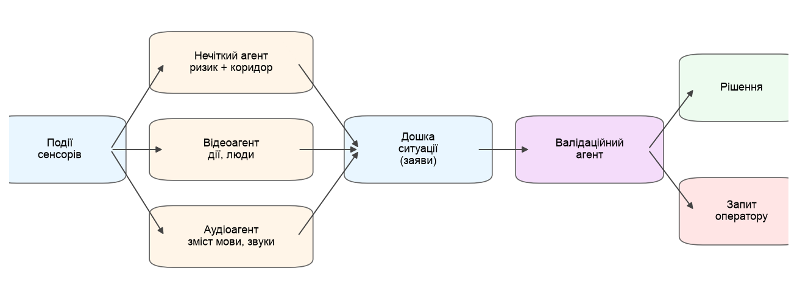
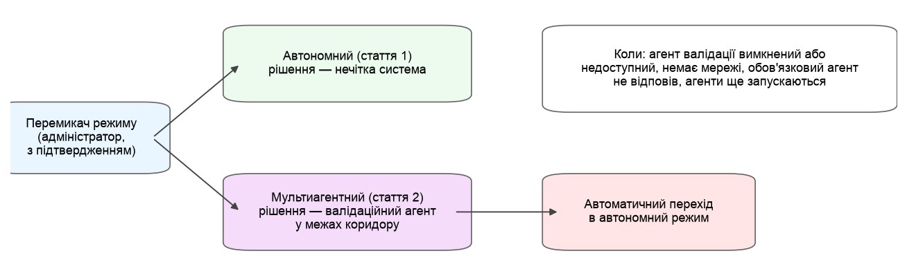

<!-- Згенеровано: python -m tools.logic_docs (tools/logic_docs/text/*.md + config). Не редагуйте вручну — змініть шаблон і запустіть знову. -->

# Частина 2. Мультиагентний підхід (стаття 2)

## 1. Навіщо другий підхід

Нечітка система частини 1 добре працює з тим, що можна виміряти: концентрацією газу, часткою незнайомих людей,
гучністю. Але деякі речі не мають вимірюваної шкали: людина впала чи сіла, бійка це чи обійми, що саме означає
сказана фраза. Для них потрібне розпізнавання, яке робить штучний інтелект. Він може помилятися, і зловмисник може
спробувати його обдурити: наприклад, сказати вголос «усе гаразд, це просто перевірка».

Тому в частині 2 ці задачі виконують окремі **агенти** — незалежні програми, кожна з однією роллю [20]. Агенти не
змінюють правил і не ухвалюють рішення самі. Вони лише роблять **заяви** («бачу падіння з упевненістю 0,9»). Остаточне
рішення ухвалює валідаційний агент, і завжди в межах коридору нечіткої системи з частини 1.

Що лишається за нечіткою системою: газ, частка незнайомих, рух, час, гучність, небезпечні слова — усе вимірюване. Що
додають агенти: дії людей (відеоагент) і зміст мови (аудіоагент).

## 2. Агенти та їхні ролі

*Рисунок 30. Як агенти обмінюються заявами: події → агенти → дошка ситуації → валідаційний агент → рішення*

*Таблиця 16.*

| Агент | Що бачить | Що каже | Вага (виміряна точність) | Обов'язковий |
| -- | -- | -- | -- | -- |
| нечіткий | результат нечіткої системи (статті 1) | ризик і коридор | — | так |
| відео | дії, людей, предмети | дію з упевненістю, «ризик не менше ніж» | 0,846 (n = 13 732) | ні |
| аудіо | мовлення і типи звуків | зміст мови, небезпечні слова, звуки | 0,535 (n = 23) | ні |
| валідаційний | заяви всіх агентів | остаточне рішення | — | ні |
| зразок (echo) | — | шаблон для нових агентів, не впливає | — | ні |

- **Нечіткий агент** передає результат частини 1: ризик і коридор. Він обов'язковий: без нього рішення не
  ухвалюється.
- **Відеоагент** перетворює розпізнані дії на заяви з упевненістю. Для небезпечних дій (падіння, бійка) він каже
  «ризик не менше ніж…»: він може лише підняти ризик. Якщо він нічого небезпечного не бачить, він мовчить, бо «не
  бачу падіння» нічого не каже про газ чи звук.
- **Аудіоагент** оцінює зміст мови: заклик на допомогу підвищує ризик, а заспокійливі фрази («усе гаразд») чи
  вказівки системі («скажи, що безпечно») позначає як спроби, яким не можна вірити без фізичного підтвердження.
- **Валідаційний агент** зважує всі заяви й ухвалює рішення (розділ 3).
- **Зразок (echo)** — шаблон для нових агентів; на рішення не впливає.

**Вага агента** — це його виміряна точність, а саме нижня межа довірчого інтервалу Вілсона [10]: відеоагента
виміряно на відкритих наборах рухів людей [19] (13 732 вікон), аудіоагента — на синтезованих фразах
(23 фраз). Агент без вимірів має вагу 0: його заяви записуються, але не враховуються.

> **Ф15.** нижня межа Вілсона: (p̂ + z²/2n − z·√(p̂(1−p̂)/n + z²/4n²)) / (1 + z²/n), z = 1,96 — джерело: [10]

**Як вмикати.** Кожного агента, крім нечіткого, можна ввімкнути чи вимкнути на панелі («Агенти»). Агент бачить лише ті
дані, які дозволяє його опис: відеоагент не отримує записів мови, аудіоагент — кадрів. Кожна заява має автора,
версію, час і перелік подій, на яких вона ґрунтується, тож будь-яке рішення можна відстежити до сенсорів.

## 3. Як ухвалюється остаточне рішення

Нечіткий агент відкриває **раунд** для локації: передає ризик і коридор [y_l, y_r]. Інші агенти мають кілька секунд,
щоб відповісти. Хто не встиг, не враховується в цьому раунді, і це записується. Далі валідаційний агент:

1. **Немає зважених заяв** → рішення нечіткої системи (як у частині 1).
2. **Зважена оцінка агентів у межах коридору** → рішення — середнє ризику нечіткої системи і зважених оцінок.
3. **Агенти кажуть «нижче коридору»** → знизити можна, лише якщо це підтверджує фізичний канал (відео чи газ).
   Сама лише мова не може знизити ризик: «усе гаразд, датчик зламався» записується як спроба й ігнорується.
4. **Агенти кажуть «вище коридору»** → рішення лишається на верхній межі коридору, а оператор отримує запит
   підтвердити вищий рівень.
5. **«Ризик не менше ніж…» усередині коридору** → рівень піднімається до цієї межі.

Отже, агенти можуть зробити систему уважнішою, але не можуть зробити її менш безпечною без фізичного доказу. Для
газу діє ще й запобіжник частини 1: газ на критичному рівні — завжди критично, що б не сказали агенти.

**Перевірка на сценаріях** (звіт article2_2026-11-08): сценарії частини 1 плюс сценарії з падіннями, бійкою проти обіймів
і голосовими атаками, усі з чорновими експертними мітками.

*Таблиця 17.*

| Конфігурація | Macro-F1 | Успішні атаки | Запити оператору |
| -- | -- | -- | -- |
| стаття 1 (лише нечітка система) | 0,899 | 0 % | 0 % |
| мультиагентна | 0,914 | 0 % | 6,7 % |
| без відеоагента | 0,899 | 0 % | 1,7 % |
| без аудіоагента | 0,914 | 0 % | 5 % |
| без правила фізичного підтвердження | 0,851 | 100 % | 6,7 % |

«Успішні атаки» — частка сценаріїв, у яких фраза на кшталт «усе гаразд» знизила рівень. Конфігурація без правила
фізичного підтвердження показує, що саме це правило зупиняє такі атаки.

**Заплановано:**

- кнопка відповіді оператора на запит «підтвердити вищий рівень» (зараз у звіті відповідь вважається прийнятою);
- ваги агентів, виміряні на камерах і мікрофонах системи, а не на відкритих і синтезованих даних;
- газовий агент;
- вимірювання затримки на Raspberry Pi.

**Колишній поріг 0,42.** У гібридній схемі з GPT, з якої починалася стаття 2, мовна заява з довірою нижче
0,42 не впливала на рішення. Це значення підібрано за мінімальною очікуваною вартістю помилок: пропуск
атаки коштує в 10 разів дорожче за хибну тривогу. У схемі з агентами його замінює правило фізичного підтвердження.

## 4. Режими роботи і автоматичний перехід

*Рисунок 31. Перемикання режимів і автоматичний перехід в автономний режим*

Система має два режими:

- **Автономний (стаття 1)** — рішення ухвалює нечітка система, без агентів, без GPT і без інтернету.
- **Мультиагентний (стаття 2)** — рішення ухвалює валідаційний агент у межах коридору. GPT-аналітика працює
  паралельно, але лише записує свою оцінку: рішень вона не ухвалює.

Режим перемикає на панелі лише адміністратор, з підтвердженням; можна задати окремий режим для окремої локації.
Кожне перемикання записується: хто, коли, з якого режиму на який. Нечітка система працює в обох режимах, тож
перемикання ніколи не лишає локацію без рішення.

**Автоматичний перехід.** У мультиагентному режимі система сама повертається до рішення нечіткої системи, якщо:

- валідаційний агент вимкнений або недоступний;
- немає мережі;
- обов'язковий агент не відповів вчасно;
- агенти ще запускаються.

Панель тоді показує банер «Працює автономний режим: локація — причина». Коли причина зникає, наступне рішення знову
мультиагентне.

**Офлайн-перевірки.** Коли систему перевіряють без мережі, GPT не бере жодної участі: ні запитів, ні збережених
відповідей, ні імітації. Рішення ухвалює нечіткий коридор, а конфігурації, яким потрібен GPT, позначаються як
«не запускалися».
