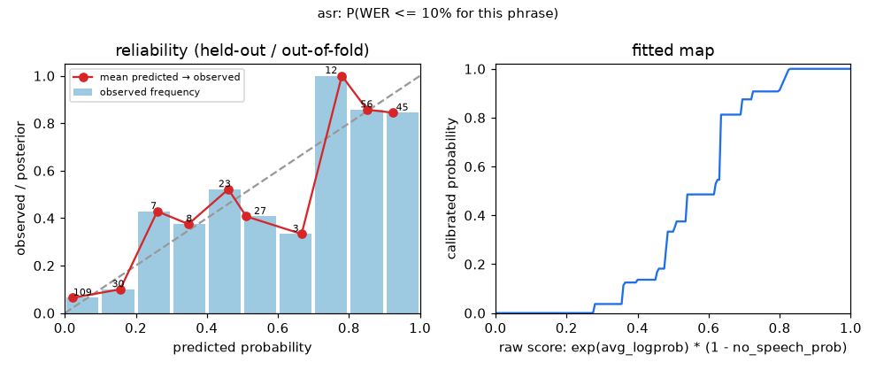
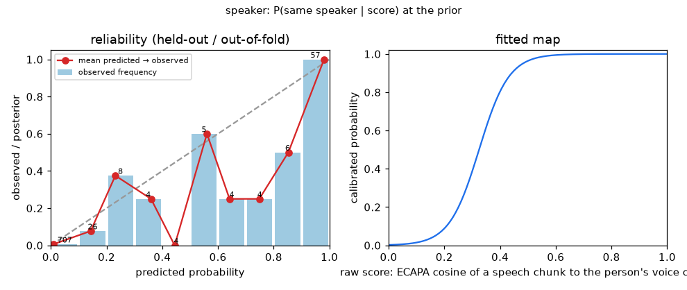
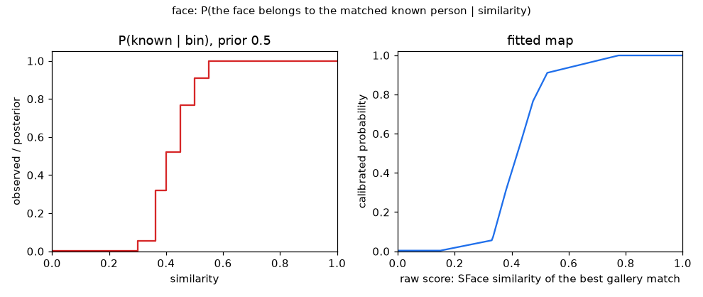
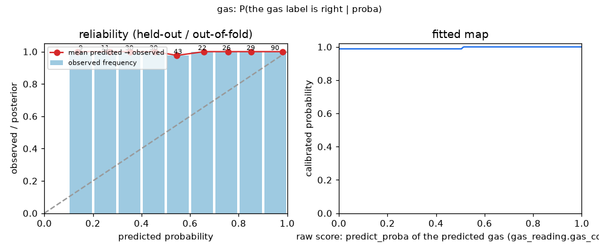

# Measured trust inputs — 2026-10-22

F22 / TOD-33. Every trust degree and decision threshold of `config/fuzzy.yaml` refers to one of the files below (`@trust_priors:…`, `@thresholds:…`, `trust.calibration`). Regenerate with `python -m tools.calibrate_channels …`, `python -m tools.trust_priors`, `python -m tools.fit_thresholds`, then `python -m tools.calibration_report`.

## 1. Channel score calibration

| channel | raw score | meaning | method | n | Brier | ECE | EER | Cllr | data sha256 |
| -- | -- | -- | -- | -- | -- | -- | -- | -- | -- |
| asr | exp(avg_logprob) * (1 - no_speech_prob) | P(WER <= 10% for this phrase) | isotonic regression | 320 | 0.1251 | 0.0608 | — | — | b3a19aafa203 |
| speaker | ECAPA cosine of a speech chunk to the person's voice centroid | P(same speaker \| score) at the prior | logistic regression (Platt) | 1760 | 0.0195 | 0.0169 | 0.0533 | 0.2153 | 0a4cfbf26c1c |
| face | SFace similarity of the best gallery match | P(the face belongs to the matched known person \| similarity) | Bayes over measured TAR / FAR bins (+0.5 Jeffreys counts), monotone | 650 | — | — | — | — | b8c7ce8eeca9 |
| gas | predict_proba of the predicted gas (gas_reading.gas_confidence) | P(the gas label is right \| proba) | isotonic regression over held-out splits | 290 | 0.0035 | 0.0005 | — | — | e056e7989a7a |

### asr

Raw score → calibrated probability: 0.1 → 0.00, 0.2 → 0.00, 0.3 → 0.04, 0.4 → 0.14, 0.5 → 0.33, 0.6 → 0.49, 0.7 → 0.88, 0.8 → 0.91, 0.9 → 1.00.

This confidence means: of the phrases at confidence 0.5, 33% had WER ≤ 10%; at 0.8 — 91%. Mean WER by SNR (dB): -5: 0.98, 0: 0.56, 10: 0.29, 20: 0.04, 30: 0.09, 5: 0.43, clean: 0.11.

Data: synthetic TTS phrases (tools/synth_speech.py) + white noise; refit on recorded phrases with the same columns.

### speaker

Raw score → calibrated probability: 0.1 → 0.01, 0.2 → 0.09, 0.3 → 0.39, 0.4 → 0.80, 0.5 → 0.96, 0.6 → 0.99, 0.7 → 1.00, 0.8 → 1.00, 0.9 → 1.00.

Held-out pairs: EER 5.3% at cosine 0.3417, Cllr 0.215 bits. At `identity.voice_threshold` 0.3: known speakers right 71/75, strangers rejected 32/75.

Data: synthetic TTS voices (tools/synth_speech.py, each voice = one speaker); real voices differ less from each other than TTS voices — refit on recorded people.

### face

Raw score → calibrated probability: 0.30 → 0.05, 0.35 → 0.15, 0.40 → 0.41, 0.45 → 0.64, 0.50 → 0.84, 0.55 → 0.92, 0.60 → 0.94.

### gas

Raw score → calibrated probability: 0.1 → 0.99, 0.2 → 0.99, 0.3 → 0.99, 0.4 → 0.99, 0.5 → 0.99, 0.6 → 1.00, 0.7 → 1.00, 0.8 → 1.00, 0.9 → 1.00.

## 2. Channel priors per device × channel (TOD-34)

11 measured, 3 unmeasured (r0 = s0 = 0 until labelled data exists).

| channel | prior status | r0 | s0 | τ0 | u0 | Wilson 95 % LB | source |
| -- | -- | -- | -- | -- | -- | -- | -- |
| camera.objects | unmeasured | 0 | 0 | 0.5 | 1.0 | 0.0 | ще не виміряно — потрібні короткі розмічені кліпи з кожної локації (людина / сумка / телефон …): правильні vs хибні детекції на трек |
| camera.motion | unmeasured | 0 | 0 | 0.5 | 1.0 | 0.0 | ще не виміряно — потрібні кліпи з реальним рухом і без нього (зокрема зміна освітлення): правильні vs хибні події руху |
| camera.pose_action | measured | 14 | 5 | 0.7143 | 0.0952 | 0.5121 | поза (стоїть / сидить / лежить / йде): 14 з 19 відео-сегментів правильні |
| camera.smoking | measured | 1 | 6 | 0.2222 | 0.2222 | 0.0257 | куріння (рука до рота): 1 з 7 епізодів виявлено |
| camera.scene_text | unmeasured | 0 | 0 | 0.5 | 1.0 | 0.0 | ще не виміряно — потрібні кадри з табличками / екранами і чи відповідав текст дійсності: узгоджені vs суперечливі |
| mic.vad | measured | 386 | 254 | 0.6028 | 0.0031 | 0.5647 | VAD: 386 з 640 кліпів правильно (мова → сегмент, лише шум → нічого) |
| mic.asr | measured | 53 | 47 | 0.5294 | 0.0196 | 0.4329 | Whisper (Whisper 1): 53 з 100 фраз з WER ≤ 10% |
| mic.asr_local | measured | 138 | 182 | 0.4317 | 0.0062 | 0.3781 | faster-whisper-base: 138 з 320 синтетичних фраз з WER ≤ 10% |
| mic.speaker | measured | 103 | 47 | 0.6842 | 0.0132 | 0.6086 | голос: 103 з 150 рішень (відомий / незнайомий) правильні на відкладених TTS-голосах, поріг 0.3 |
| gas.gas_class | measured | 29 | 0 | 0.9677 | 0.0645 | 0.883 | класифікатор газу: 29 з 29 відкладених кривих розпізнано правильно |
| gas.gas_concentration | measured | 29 | 0 | 0.9677 | 0.0645 | 0.883 | концентрація: 29 з 29 відкладених кривих у межах ±0.5 % |
| gas.gas_trend | measured | 1380 | 0 | 0.9993 | 0.0014 | 0.9972 | тренд газу: 1380 з 1380 оцінок правильні на відтворених рампах / утриманнях |
| identity.face_known | measured | 150 | 0 | 0.9934 | 0.0132 | 0.975 | «це відома людина»: 150 правильних, 0 хибно прийнятих незнайомців (LFW, поріг 0.45) |
| identity.face_unknown | measured | 500 | 0 | 0.998 | 0.004 | 0.9924 | «незнайома людина»: 500 незнайомців відхилено, 0 відомих пропущено (LFW) |

Rules and interim values (`policy`, `measured: false`):

| name | value | why |
| -- | -- | -- |
| deescalation_floor | 0.1 | заспокійлива заява при повністю тривожних сенсорах: майже не віримо |
| instruction | 0.05 | інструкція системі («скажи, що безпечно») довіри не отримує ніколи |
| gas_disagreement_pct | 1.0 | два датчики газу розходяться більше ніж на 1 % концентрації — вважаємо розбіжністю |

## 3. Cost-based thresholds

Cost ratio C_miss / C_fa = **10.0** (the only expert input, `calibration.cost_ratio`); dataset scripted-42 (synthetic), calibration split, 36 scenarios, hash `f6d67b63603b`.

| threshold | value | expected cost | P_miss | P_fa | pos / neg | status |
| -- | -- | -- | -- | -- | -- | -- |
| envelope.theta | 0.61 | 0.0 | 0.0 | 0.0 | 33 / 1433 | fitted |
| level medium | 0.24 | 0.002 | 0.0 | 0.0 | 12 / 12 | kept: only 3 calibration scenarios with recorded GPT answers |
| level high | 0.53 | 0.0013 | 0.0 | 0.0 | 10 / 14 | kept: only 3 calibration scenarios with recorded GPT answers |
| level critical | 0.78 | 0.0102 | 0.0 | 0.0 | 8 / 16 | kept: only 3 calibration scenarios with recorded GPT answers |
| gating.threshold | 0.4 | 0.5 | 0.0 | 0.5 | 2 / 20 | fitted |

`gating.critical_floor` = level critical = 0.78. Not applicable yet: lambda — corridor risk attitude — not in the code yet (corridor issue); h_min — agreement threshold — not in the code yet (corridor issue).
